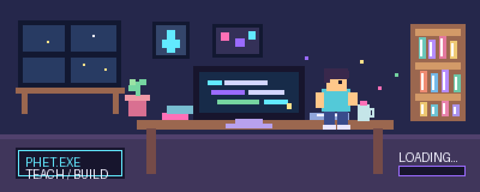

<div align="center">



### 🕹️ PLAYER 01: PHET KAMONPHET
**COMPUTER TEACHER · BUILDER · CYBERSECURITY LEARNER**


[](https://github.com/Kamonphet)
[](https://sites.google.com/view/kamonphet-sirirattanasakkul/home)


</div>

---

## 🟪 `PLAYER PROFILE`

```text
NAME       Phet Kamonphet
CLASS      Computer Teacher
BASE       Thailand
MISSION    Make technology fun to learn and useful to build
```

I’m a computer teacher who likes turning ideas into hands-on projects. I’m interested in programming, cybersecurity, and creative media—from exploring systems through CTFs to capturing and editing photos and video.

## 🟦 `SELECT YOUR QUEST`

| 🧑‍🏫 **TEACH** | 🛡️ **EXPLORE** | 📸 **CREATE** |
| :---: | :---: | :---: |
| Computer education<br />Learn by doing | Cybersecurity<br />CTF practice | Photography<br />Photo & video editing |

## 🟩 `EQUIPPED SKILLS`

<div align="center">


</div>

## 🟨 `QUEST LOG — FEATURED PROJECTS`

<div align="center">

<a href="https://github.com/Kamonphet/zero-trust-game"></a>
<a href="https://github.com/Kamonphet/Krutan"></a>
<a href="https://github.com/Kamonphet/ED-Oasis"></a>
<a href="https://github.com/Kamonphet/NewgenHackathon"></a>

</div>

<details>
<summary>🧩 <b>More projects</b></summary>
<br />

- [subnet-test](https://github.com/Kamonphet/subnet-test)
- [Eng-game_img-tracking](https://github.com/Kamonphet/Eng-game_img-tracking)

</details>

## 🟥 `PLAYER STATS`

<div align="center">


<br />


</div>

---

<div align="center">

**[ GAME LOOP: LEARN → BUILD → SHARE → REPEAT ]**

<sub>Thanks for visiting my pixel corner of GitHub. See you on the next quest! 👾</sub>

</div>
